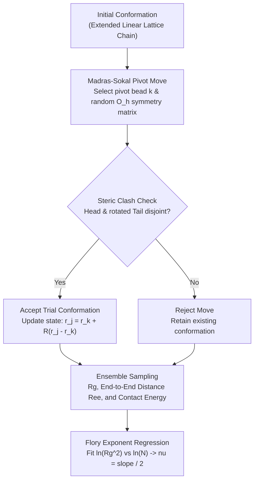

# PolyConform

[](https://github.com/ZengLLQ/poly-conform/actions/workflows/ci.yml)
[](LICENSE)
[](https://www.python.org)

**PolyConform** is a statistical physics computational simulation engine written in pure Python for **3D Lattice Polymer Self-Avoiding Walks (SAW)**, global conformational sampling via the **Madras-Sokal Pivot Algorithm**, gyration tensor calculation, and **Flory Scaling Exponent** ($\nu$) extraction.

---

## Physical and Mathematical Formulation

### 1. Lattice Self-Avoiding Walk (SAW)

A polymer chain of $N$ monomers is represented as a connected sequence of vertices $\mathbf{r}_0, \mathbf{r}_1, \dots, \mathbf{r}_{N-1} \in \mathbb{Z}^3$ on a simple cubic lattice satisfying:
1. **Connectivity:** $\|\mathbf{r}_{i+1} - \mathbf{r}_i\|_1 = 1$ for all $0 \le i < N - 1$.
2. **Self-Avoidance (Excluded Volume):** $\mathbf{r}_i \ne \mathbf{r}_j$ for all $i \ne j$.

---

### 2. Radius of Gyration Tensor & Asphericity

The $3 \times 3$ gyration tensor $\mathbf{S}$ characterizes the spatial distribution and shape of the polymer coil:

$$S_{\alpha\beta} = \frac{1}{N} \sum_{i=0}^{N-1} (r_{i,\alpha} - r_{\text{com},\alpha})(r_{i,\beta} - r_{\text{com},\beta})$$

where $\mathbf{r}_{\text{com}} = \frac{1}{N} \sum_{i=0}^{N-1} \mathbf{r}_i$ is the center of mass.

The squared radius of gyration $R_g^2$ is the trace of $\mathbf{S}$:

$$R_g^2 = \text{Tr}(\mathbf{S}) = \frac{1}{2 N^2} \sum_{i=0}^{N-1} \sum_{j=0}^{N-1} \|\mathbf{r}_i - \mathbf{r}_j\|^2$$

For an ideal linear rod along an axis, $R_g$ has the exact analytical form:

$$R_g^2 = \frac{N^2 - 1}{12}$$

---

### 3. Madras-Sokal Pivot Algorithm

Global ergodic conformational sampling is executed via the pivot move:
1. Select a random pivot monomer $k \in [0, N-2]$.
2. Select a random symmetry operator $R \in \mathcal{O}_h$ from the 48 elements of the octahedral cubic point group.
3. Transform the tail monomers $j \in [k+1, N-1]$:
   $$\mathbf{r}'_j = \mathbf{r}_k + R (\mathbf{r}_j - \mathbf{r}_k)$$
4. Accept the candidate conformation if and only if the self-avoidance constraint is preserved without steric clashes.

---

### 4. Flory Scaling Exponent

The spatial dimension of an unconstrained polymer coil scales with chain length $N$ according to Flory's universal scaling law:

$$\langle R_g^2 \rangle \sim N^{2\nu}$$

- **Good Solvent (Athermal SAW):** $\nu \approx 0.588$ (swollen coil, self-avoidance dominates).
- **Theta Solvent ($\theta$-temperature):** $\nu = 0.5$ (ideal unperturbed Gaussian random walk).
- **Poor Solvent (Collapse):** $\nu = 1/3 \approx 0.333$ (compact globule).

---

## Architectural Flowchart



---

## Quickstart

```python
import numpy as np
from poly_conform import PolymerChain, sample_polymer_ensemble, estimate_flory_exponent

# 1. Inspect single polymer conformation
chain = PolymerChain.linear_chain(15)
print(f"Linear Chain Rg: {chain.radius_of_gyration():.3f}")

# 2. Sample equilibrium SAW ensemble for multiple lengths
lengths = [10, 16, 24, 32]
rg2_means = []

for length in lengths:
    stats = sample_polymer_ensemble(length, total_steps=600, burn_in=100)
    print(f"N={length:2d} -> Mean Rg: {stats['mean_rg']:.3f}, Ree: {stats['mean_ree']:.3f}")
    rg2_means.append(stats['mean_rg_sq'])

# 3. Estimate universal Flory scaling exponent
nu, r2 = estimate_flory_exponent(lengths, rg2_means)
print(f"Estimated Flory Exponent nu: {nu:.3f} (R^2 = {r2:.3f})")
```

---

## Testing

```bash
pytest -v
```

---

## License

MIT License. Copyright (c) 2026 ZengLLQ.
